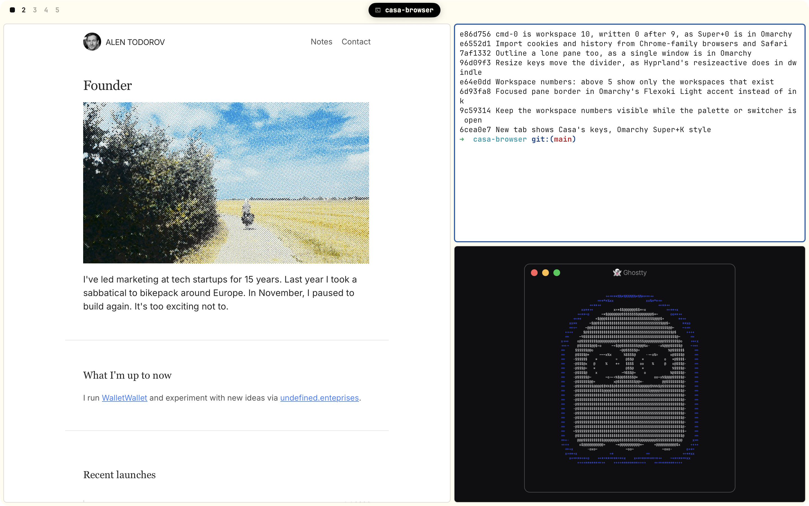
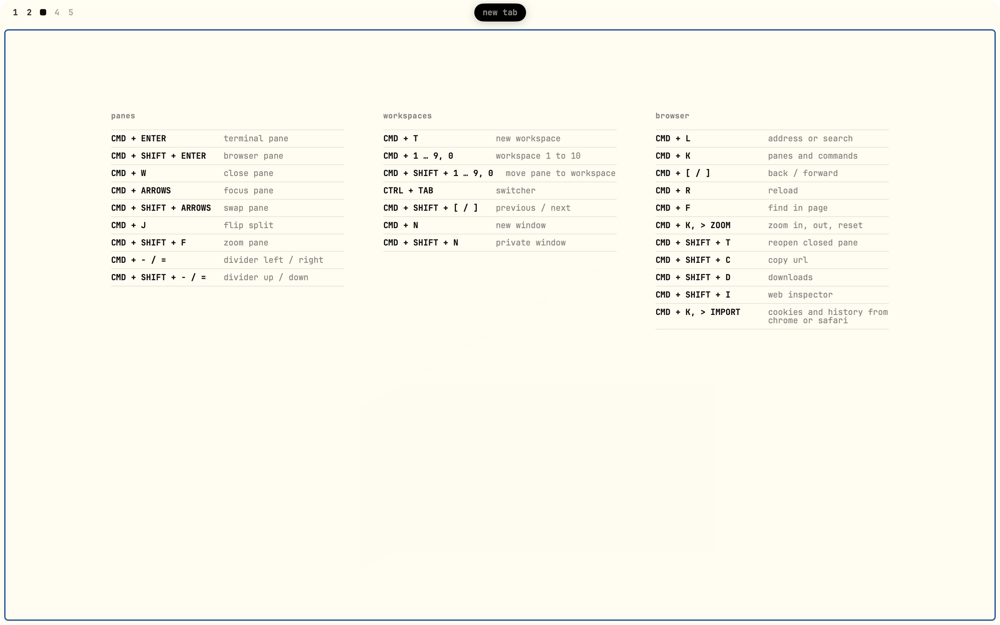
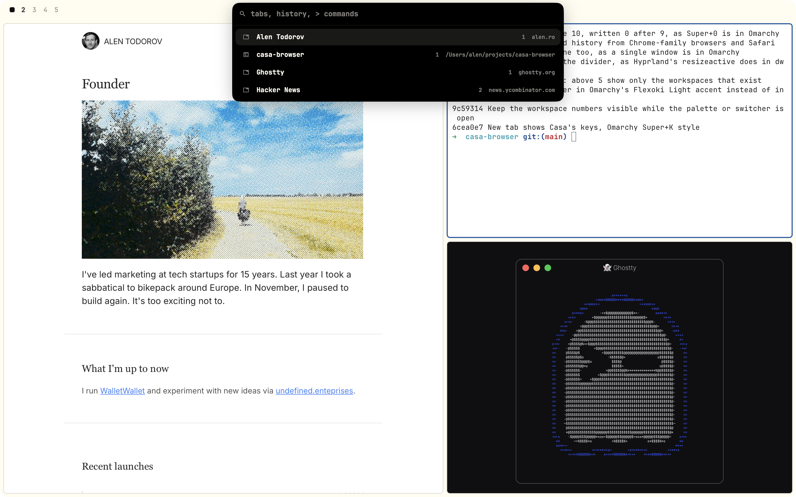

# Casa

A small macOS browser that tiles like Hyprland in [Omarchy](https://omarchy.org). Workspaces hold browser and terminal panes, and the keyboard moves them.

- Web pages (WKWebView) and terminals (libghostty) as panes in a dwindle layout.
- Omarchy's keys, with Cmd as Super. A new tab lists them.
- One palette for panes, history, addresses and commands.
- Imports cookies and history from Chrome-family browsers and Safari.
- Flexoki Light and JetBrainsMono Nerd Font. No toolbar, no tab strip.

| | |
|---|---|
|  |  |

## Install

Download `Casa.zip` from [Releases](../../releases). Apple Silicon, macOS 26.

The build is not notarized, so clear the quarantine flag once:

    xattr -dr com.apple.quarantine /Applications/Casa.app

It expects the font: `brew install --cask font-jetbrains-mono-nerd-font`.

## Built for my desk

Casa assumes two things about the Mac it runs on. Both can be turned off.

- **Cmd and Option swapped system-wide.** Casa swaps them back while it is in front, which needs Accessibility access. If yours are not swapped: `defaults write com.alentodorov.casa KeySwap -bool NO`
- **AeroSpace.** Each window goes to workspace 8, fullscreen. Pick another with `defaults write com.alentodorov.casa AeroSpaceWorkspace 3`, or `none`.

## Build

    ./build.sh

Plain `swiftc`, no Xcode project. The libghostty static library is not in the repo; `vendor/README.md` has the recipe. `HANDOFF.md` describes the code.

## Credits

[Ghostty](https://ghostty.org) for the terminal, [Omarchy](https://omarchy.org) and Hyprland for the layout and keys, [cmux](https://github.com/manaflow-ai/cmux) for the import approach, [Flexoki](https://stephango.com/flexoki) for the colours.
